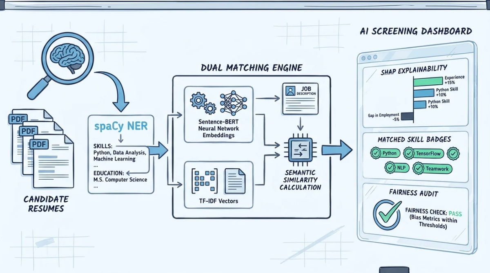

# AI-powered resume screening and ranking system for recruiters.

Technical Explanation: https://www.youtube.com/watch?v=IIVtJ4vOCNI&t=74s



This project is a Flask-based application that helps recruiters review resumes faster, rank candidates against a job description, explain the decision, and audit whether the system is unfairly biased.

It was built as a research project and uses a custom spaCy NER model trained on the final dataset file `Entity_Recognition_in_Resumes.json`.

---

## What the project does

- Applicants upload a resume in PDF/DOCX format.
- The system extracts structured information from the resume such as:
  - name
  - skills
  - education
  - experience
  - email and phone
  - designation and company history
- Recruiters add a Job Description (JD).
- The app compares each resume to the JD and ranks candidates.
- The system explains the score using XAI-style contribution breakdowns.
- It also runs a fairness audit by masking sensitive identity signals and testing score changes.

---

## Research questions and solutions

### RQ1: Can a spaCy NER model extract structured information from resumes?

Solution:
- Train a custom spaCy NER model using the Dataturks dataset file `Entity_Recognition_in_Resumes.json`.
- Extract resume entities such as Name, Skills, Designation, Companies worked at, College Name, Degree, Graduation Year, Email Address, and Location.
- Use regex fallback for fields that NER may miss.

Relevant files:
- `Entity_Recognition_in_Resumes.json`
- `dataturks_dataset.py`
- `app/nlp/train_ner.py`
- `app/nlp/parser.py`

### RQ2: Does Sentence-BERT outperform TF-IDF for resume-to-job matching?


Solution:
- Build a dual matching engine using:
  - TF-IDF baseline matching
  - Sentence-BERT semantic matching
- Combine both models into a final ranking score.
- Weight the final score using skills, experience, and education sections.

Relevant files:
- `app/nlp/ranker.py`
- `app/nlp/vectorizer.py`
- `app/nlp/xai.py`

### RQ3: Can counterfactual testing detect bias in automated screening?

Solution:
- Mask sensitive text such as names, gender pronouns, dates, college names, and locations.
- Compare the original score against the anonymized score.
- If the score changes significantly, the model may be overly dependent on protected or proxy attributes.

Relevant files:
- `app/nlp/fairness.py`

---

## Project structure

- `app/` — main Flask application
- `app/routes/` — applicant and recruiter routes
- `app/models/` — MongoDB models for users, resumes, and job descriptions
- `app/nlp/` — parsing, ranking, fairness, and training logic
- `docs/` — supporting technical documentation
- `Entity_Recognition_in_Resumes.json` — final dataset used for NER training
- `requirements.txt` — Python dependencies
- `run.py` — app entry point

---

## How to run the application

### 1) Install dependencies

```bash
pip install -r requirements.txt
```

### 2) Install spaCy English model

```bash
python -m spacy download en_core_web_sm
```

### 3) Make sure MongoDB is running

By default, the app connects to:

```text
mongodb://localhost:27017/airesume
```

If needed, update the `MONGO_URI` in the Flask app configuration or environment variables.

### 4) Run the app

```bash
python run.py
```

Then open:

```text
http://localhost:5000
```

---

## Optional: retrain the custom NER model

The project uses the final dataset file as-is:

```bash
python -m app.nlp.train_ner --data "Entity_Recognition_in_Resumes.json" --iter 30
```

This saves the trained model under:

```text
app/nlp/models/spacy_ner/
```

---

## How the app is used

### For applicants

1. Register as an applicant.
2. Upload a resume.
3. The resume is parsed and structured.
4. The candidate profile is stored for ranking.

### For recruiters

1. Register as a recruiter.
2. Add a job description.
3. Rank all resumes for that JD.
4. Review the ranked candidates.
5. Open XAI insights to understand score explanations.
6. Review fairness audit results for bias detection.

---

## Notes

- This is a research prototype and academic project, not a production HR platform.
- The project keeps the final dataset file as the authoritative source and does not rely on duplicate or cleaned dataset variants.
- Additional documentation is available in the `docs/` folder.

